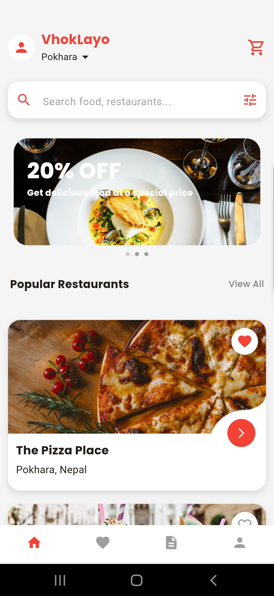
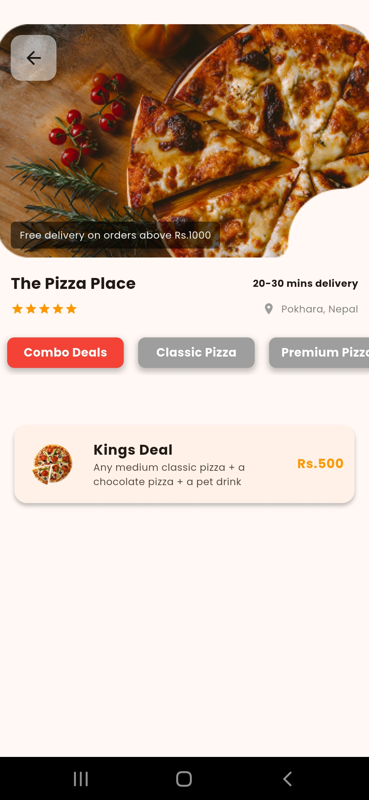
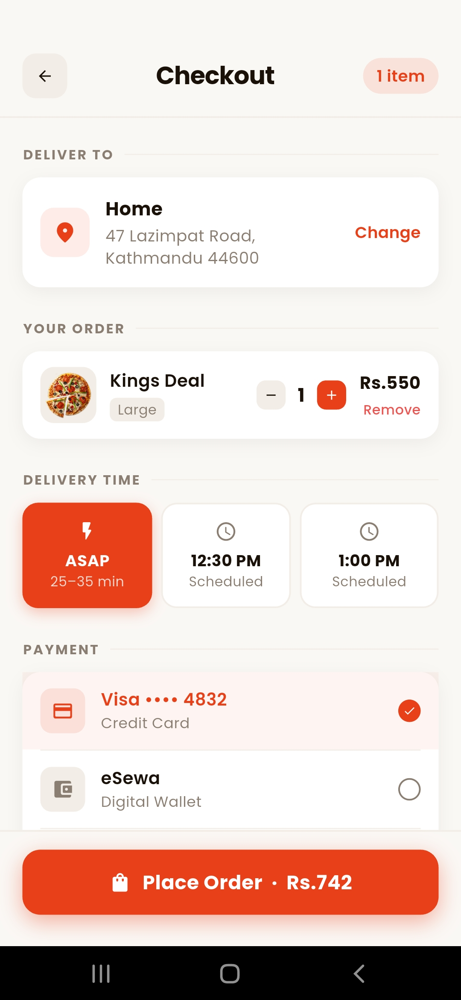
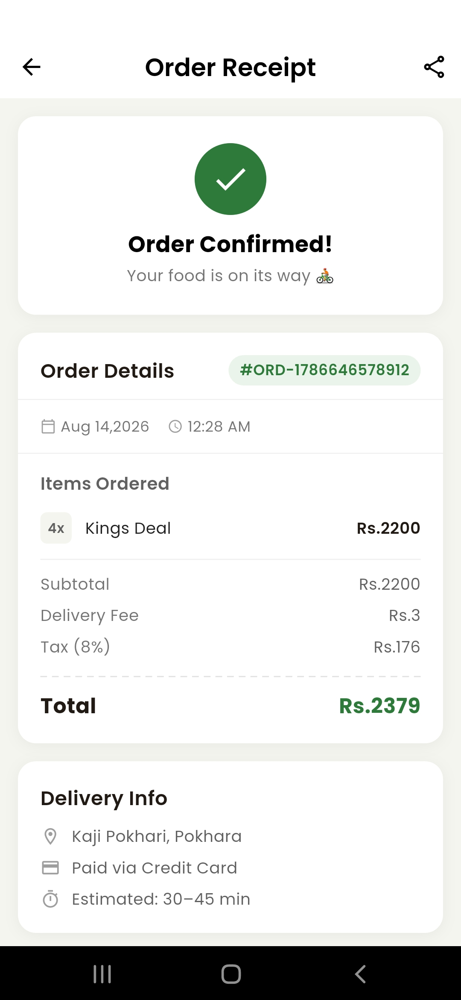
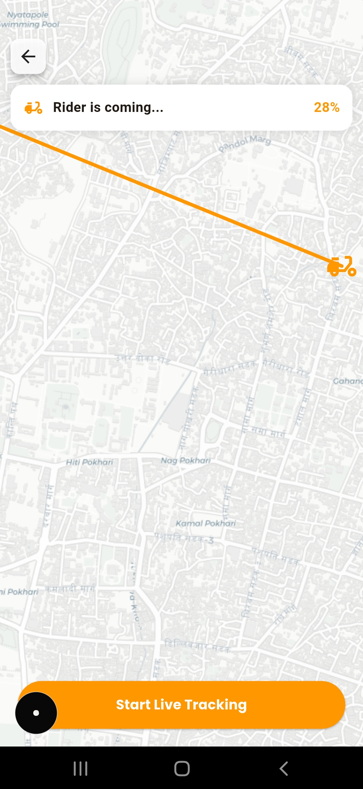
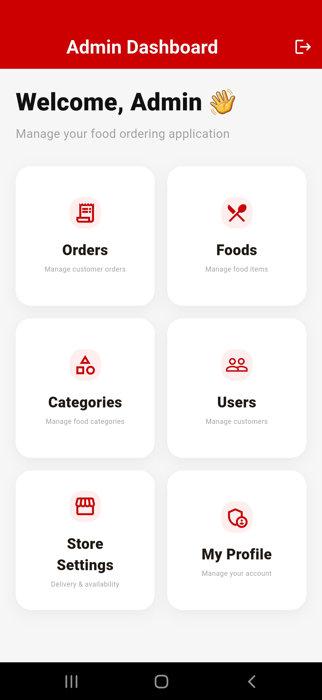
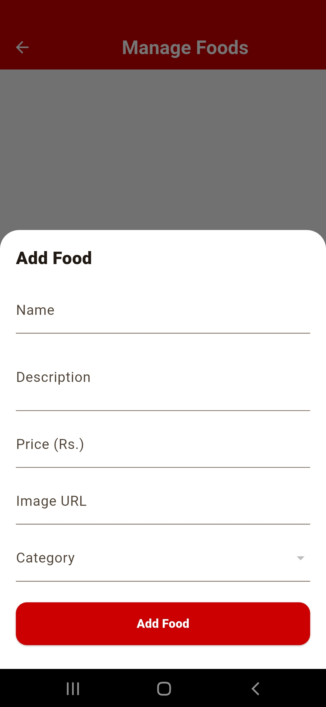
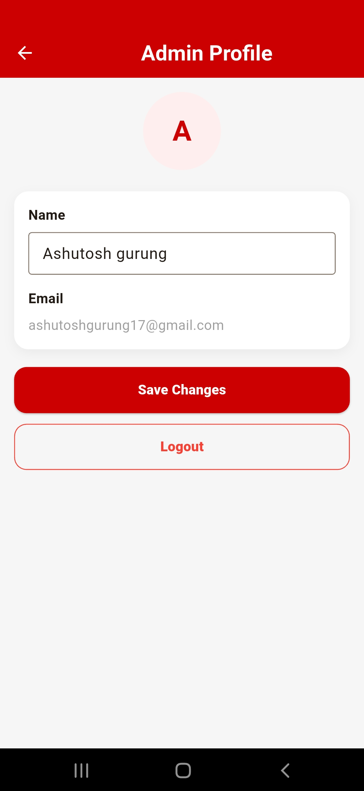
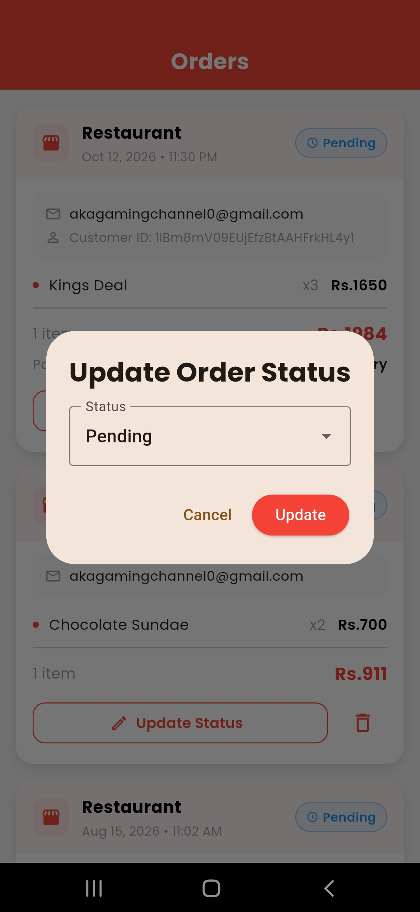
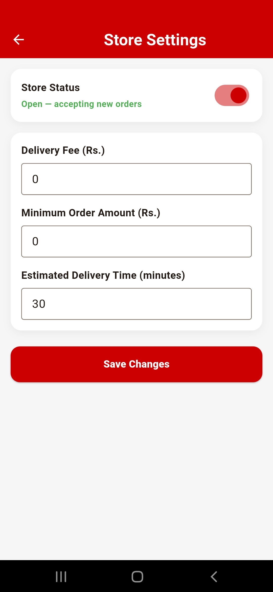

# Food Ordering App

A full-stack mobile food ordering platform built with Flutter and Firebase. It includes a customer app for ordering and paying online, and an admin dashboard for managing the menu, orders and users.

## Overview

Customers browse restaurants, build a cart, choose a delivery location on a map and pay with Khalti. Administrators sign in to the same app and manage categories, food items, orders and users. Payments are verified by a small Node.js backend so the Khalti secret key is never stored in the mobile client.

## Features

### Customer

- Email/password and Google sign-in
- Restaurant and food browsing, search and favourites
- Cart with local persistence
- Delivery address selection using current location and an interactive map
- Online payment with Khalti
- Order history, delivery progress and receipts
- Profile management with image upload

### Admin

- Dashboard overview
- Category and food item management with image upload
- Order management with status updates and order details
- User management
- Store settings and admin profile

## Screenshots

### Customer







### Admin







## Tech Stack

| Layer             | Technology                                        |
| ----------------- | ------------------------------------------------- |
| Framework         | Flutter, Dart                                     |
| State management  | Provider (MVVM)                                   |
| Authentication    | Firebase Authentication, Google Sign-In           |
| Database          | Cloud Firestore                                   |
| File storage      | Firebase Storage                                  |
| Local storage     | Hive                                              |
| Payments          | Khalti SDK, Node.js (Express) verification server |
| Maps and location | flutter_map, geolocator, geocoding                |

## Architecture

```
lib/
  model/        Data models
  view/         Screens (customer and admin)
  viewmodel/    State and business logic (Provider)
  services/     Firebase, Khalti and location services
khalti_express_backend/   Payment verification server
```

The app follows an MVVM structure. UI code lives in `view`, state and logic in `viewmodel`, and all external integrations are isolated in `services`.

## Getting Started

### Prerequisites

- Flutter SDK (Dart ^3.11.4)
- A Firebase project with Authentication, Cloud Firestore and Storage enabled
- A Khalti merchant account (test credentials are sufficient)
- Node.js 18 or later

### Run the app

```bash
git clone https://github.com/ashutoshgurung/delivery-app.git
cd delivery-app
flutter pub get
flutterfire configure
flutter run
```

Firebase configuration is not committed. Run `flutterfire configure` to generate `lib/firebase_options.dart`, and place your `google-services.json` in `android/app/`.

### Run the payment backend

```bash
cd khalti_express_backend
npm install
node index.js
```

Create a `.env` file in this folder with your Khalti secret key before starting the server.

### Admin access

Set the `role` field to `admin` on your user document in the Firestore `users` collection, then sign in.

## Author

**Ashutosh Gurung**
GitHub: [ashutoshgurung](https://github.com/ashutoshgurung)

**Ashutosh Gurung**
Linkedln: [ashhutoshgurung](https://www.linkedin.com/in/ashutosh-gurung-a14ab1353/)
